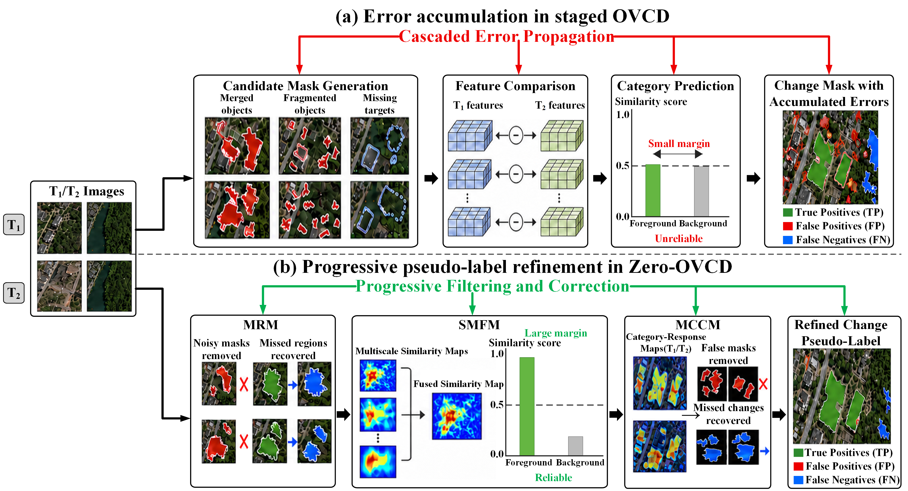
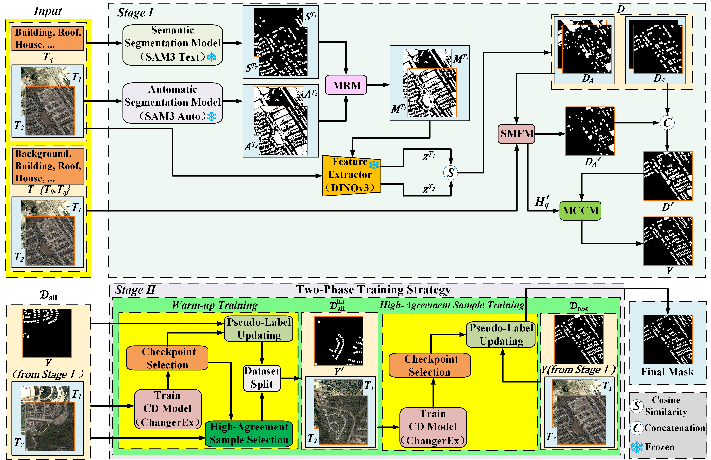

<h1 align="center">Zero-OVCD</h1>

<h2 align="center">
Bridging Training-Free Foundation Models and Pseudo-Label Learning for Open-Vocabulary Change Detection
</h2>

  <a href="https://arxiv.org/abs/2602.06529">arXiv</a>

## Overview

**Zero-OVCD** is a two-stage framework for open-vocabulary change detection (OVCD) in remote sensing imagery that requires **no manual annotations throughout the complete pipeline**. It bridges training-free vision foundation model inference with noise-aware pseudo-label learning, enabling category-specific change detection from natural-language prompts.

Existing training-free OVCD pipelines are susceptible to errors caused by inaccurate candidate masks, ambiguous semantic assignments, and error accumulation across sequential inference stages. Zero-OVCD addresses these limitations by progressively refining the intermediate predictions rather than directly treating staged inference results as final change masks.

  

## Framework Overview

Zero-OVCD consists of two stages: **training-free change pseudo-label generation** and **noise-aware pseudo-label learning**.

In **Stage I**, frozen vision foundation models are used to generate high-quality category-specific change pseudo-labels. The pipeline progressively reduces different types of inference errors through three complementary modules:

- **Mask Refinement Module (MRM):** refines multi-source candidate masks by exploiting the complementarity between automatic and text-guided semantic masks.
- **Similarity-Based Multiscale Fusion Module (SMFM):** performs multiscale semantic verification and background-aware margin filtering to improve the reliability of category assignments.
- **Mask Correction and Completion Module (MCCM):** removes residual false-positive proposals and recovers potentially missed change regions using cross-temporal target-category responses.

In **Stage II**, the Stage I pseudo-labels are used to train a category-specific change detector. A two-phase noise-aware learning strategy performs checkpoint-based pseudo-label updating and high-agreement sample selection to mitigate residual pseudo-label noise. Final predictions are obtained by voting over selected checkpoint predictions together with the corresponding Stage I pseudo-labels.

  

> **Code:** The source code will be made available upon paper acceptance.
